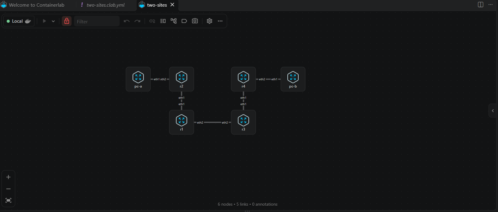
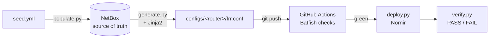
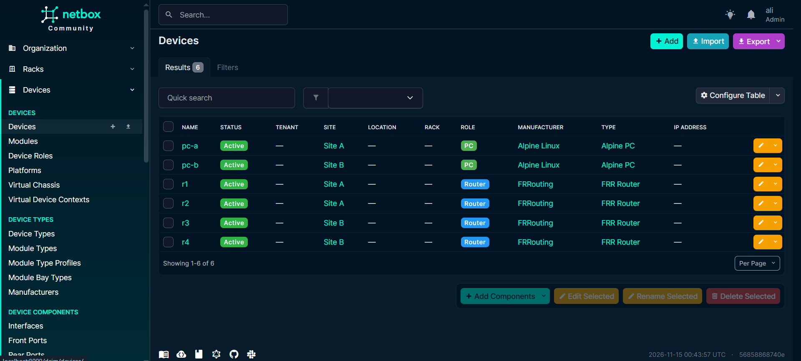
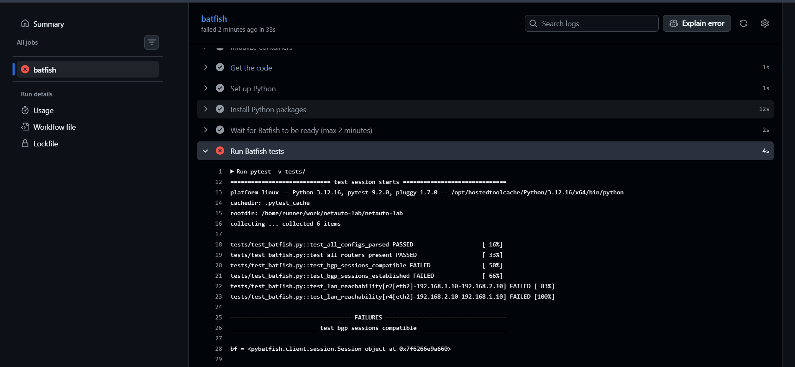
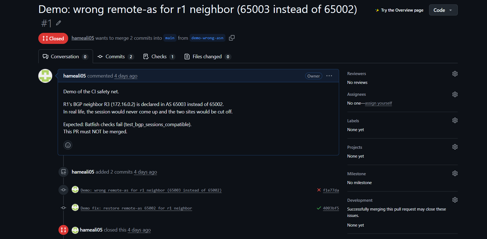

# netauto-lab

**A network automation pipeline on a 4-router FRR lab:**
NetBox (source of truth) → Jinja2 config generation → Batfish checks in GitHub Actions → Nornir deploy → automated PASS/FAIL verification.

No router config is typed by hand. Every change starts in NetBox, is checked by CI before it can be deployed, and is verified on the real routers afterwards.


---

## Topology



Two sites, 4 FRR routers and 2 Alpine PCs, all running as containers in Containerlab.

| Site | Routers | AS    | Inside the site | LAN                  |
|------|---------|-------|-----------------|----------------------|
| A    | R1, R2  | 65001 | OSPF area 0     | 192.168.1.0/24 (PC-A) |
| B    | R3, R4  | 65002 | OSPF area 0     | 192.168.2.0/24 (PC-B) |

- **eBGP** between R1 and R3 (172.16.0.0/30) connects the two sites.
- Each router has a loopback (1.1.1.1 … 4.4.4.4).
- eth0 is the management interface and is never used for routing.

Goal: PC-A (192.168.1.10) and PC-B (192.168.2.10) can reach each other across the two sites.

---

## The pipeline



| Step | Tool | What it does |
|------|------|--------------|
| 1. Data | `netbox/populate.py` (pynetbox) | Loads all lab data (sites, devices, interfaces, IPs, ASNs, OSPF/BGP settings) from `netbox/seed.yml` into NetBox. Safe to run many times: no duplicates. |
| 2. Generate | `generate.py` (pynetbox + Jinja2) | Reads NetBox and fills `templates/frr.j2` to produce one `frr.conf` per router. The configs are committed to Git. |
| 3. Check | GitHub Actions + Batfish | On every push and pull request, Batfish builds a model of the network from the configs (no router needed) and runs the tests. |
| 4. Deploy | `deploy.py` (Nornir) | Copies each config into its router and applies **only the differences** with `frr-reload.py`. Run by hand from the laptop. |
| 5. Verify | `verify.py` | Compares the **expected** state (from NetBox) with the **real** state (from the routers) and prints a PASS/FAIL table. |



*NetBox holds the full lab: 4 routers and 2 PCs, with their interfaces, IPs and routing data.*

---

## Tech stack

| Area | Tools |
|------|-------|
| Lab | Containerlab, FRRouting 10.2.1, Alpine Linux, Docker, WSL2 |
| Source of truth | NetBox (netbox-docker), pynetbox, config contexts |
| Config generation | Python, Jinja2 |
| Testing / CI | Batfish (pybatfish), pytest, GitHub Actions |
| Deploy / verify | Nornir, nornir_netbox, FRR `frr-reload.py`, `vtysh ... json` |

---

## CI safety net: demo with a wrong ASN

To prove that CI blocks a bad change, I opened [pull request #1](https://github.com/hameali05/netauto-lab/pull/1) with a mistake: R1's BGP neighbor R3 declared in **AS 65003** instead of 65002. In real life, the BGP session would never come up, and the two sites would be cut off.

**1. CI goes red.** Batfish finds the problem before any router is touched: 2 tests pass, 4 fail (BGP compatibility, BGP session, and LAN reachability in both directions).



**2. Fix pushed, CI goes green.** The wrong commit keeps its red ✗, and the fix gets a green ✓. The PR was then closed **without merging**, so `main` never contained the mistake.



**What Batfish checks** (`tests/test_batfish.py`):
1. All 4 configs are read without errors (and all 4 routers are present).
2. The eBGP session R1 ↔ R3 is compatible on both sides and can come up.
3. LAN A can reach LAN B, in both directions.

---

## Deploy and verify

### `deploy.py`

```bash
.venv/bin/python deploy.py --dry-run        # show what would change, change nothing
.venv/bin/python deploy.py                  # deploy
```

- **Inventory from NetBox:** Nornir gets the list of routers from NetBox (role "router"). No hosts file.
- **CI gate:** before a real deploy, it asks the GitHub API if the "Batfish checks" run for the current commit is green, and refuses if it isn't. It also refuses if `configs/` has uncommitted changes. (`--skip-ci-check` bypasses the gate and prints a warning.)
- **Only the differences:** `frr-reload.py` applies only the changed lines (no FRR restart). Then it runs a second check, which must find no difference left.
- **No SSH:** the FRR image has no SSH server, so Nornir talks to the routers with `docker cp` / `docker exec`.

### `verify.py`

```bash
.venv/bin/python verify.py                  # one run
.venv/bin/python verify.py --wait 60        # retry failed checks for up to 60 s (after a fresh deploy)
```

Read-only (only `show` commands and pings). Nothing is hard-coded: the expected state comes from NetBox, so if NetBox changes, the checks change with it.

| # | Check |
|---|-------|
| 1 | OSPF neighbors are Full |
| 2 | OSPF interfaces are passive where expected |
| 3 | BGP sessions are Established |
| 4 | BGP receives the peer's prefixes |
| 5 | Every router has every loopback and LAN in its routing table |
| 6 | Every PC pings every other PC |

Current result: **20/20 PASS**.

### Tests done

- **Drift / negative test:** I broke R3 eth2 by hand → `verify.py` FAIL → `deploy.py` repaired it → `verify.py` all PASS.
- **Full pipeline test:** I made a new change in NetBox (R1 and R3 announce their site transit link in BGP) → generate → push → CI green → deploy (+1 line on r1/r3) → verify 20/20.
- **From zero:** destroy the lab, redeploy it, then `deploy.py` and `verify.py --wait 60` → all PASS.

---

## Repository layout

```
.
├── two-sites.clab.yml        # Containerlab topology (4 routers, 2 PCs, 5 links)
├── frr/                      # daemons + vtysh.conf, shared by the 4 routers
├── netbox/
│   ├── seed.yml              # all lab data (the input for NetBox)
│   └── populate.py           # loads seed.yml into NetBox (idempotent)
├── templates/frr.j2          # Jinja2 template for frr.conf
├── generate.py               # NetBox -> configs/
├── configs/<router>/frr.conf # generated configs (what CI checks and deploy.py sends)
├── tests/test_batfish.py     # Batfish tests (run in CI)
├── .github/workflows/ci.yml  # GitHub Actions workflow
├── deploy.py                 # Nornir deploy, with dry-run and CI gate
├── verify.py                 # PASS/FAIL checks on the live lab
├── reference-configs/        # Phase 1 hand-made configs (frozen baseline)
└── docs/                     # project plan + screenshots
```

---

## How to run it

**Prerequisites:** Linux (or WSL2), Docker, Containerlab, Python 3.12, a running [NetBox](https://github.com/netbox-community/netbox-docker) instance with an API token.

```bash
# 1. Python environment
python3 -m venv .venv
.venv/bin/pip install -r requirements.txt

# 2. NetBox access: create a .env file (it is in .gitignore, never commit it)
cat > .env <<'EOF'
NETBOX_URL=http://localhost:8000
NETBOX_TOKEN=<your-api-token>
EOF

# 3. Start the lab
sudo containerlab deploy -t two-sites.clab.yml

# 4. Source of truth -> configs
.venv/bin/python netbox/populate.py
.venv/bin/python generate.py

# 5. (optional) Run the Batfish tests locally
docker run -d --name batfish -p 9996:9996 batfish/batfish:2026.08.27.3685
.venv/bin/pytest -v tests/

# 6. Deploy and verify
.venv/bin/python deploy.py --dry-run
.venv/bin/python deploy.py
.venv/bin/python verify.py --wait 60
```

> On a machine with 8 GB of RAM, don't run NetBox and Batfish at the same time.

---

## Design decisions and limits

- **Batfish has no plain-FRR format.** The tests wrap each `frr.conf` in the Cumulus "concatenated" format, in a temporary snapshot. `configs/` itself is not changed.
- **Batfish doesn't understand 4 normal FRR lines** (`exit`, `domainname`, `no bgp ebgp-requires-policy`, `ip ospf passive`). The parse test accepts exactly these 4 lines and fails on any other unknown line. Batfish can't check OSPF passive or `ebgp-requires-policy`, so `verify.py` checks them on the real routers.
- **CI only checks. Deploy is manual.** GitHub's runners can't reach a lab on my laptop, and a human decides when to deploy. The CI gate in `deploy.py` makes sure only green commits get deployed.
- **One source for each fact.** The local AS number comes from the site's ASN object in NetBox, not from the OSPF/BGP config context.
- **Everything is pinned:** Python packages, the Batfish image, the runner OS and the GitHub Actions versions. Upgrades are done on purpose.
- **`reference-configs/` is frozen.** It keeps the configs I built by hand in Phase 1, as a baseline. The current configs are in `configs/`.
- **Known limit:** after a PC restart, Docker restarts the containers but Containerlab doesn't recreate the links. The fix is `containerlab destroy` + `deploy`, then `deploy.py` and `verify.py --wait 60`.

---

## Possible improvements

- **Scheduled drift detection:** run `verify.py` on a timer (cron) and send an alert when a check fails. That catches manual changes made directly on a router.
- **Cables in NetBox:** model the links as NetBox cables to get a topology view in NetBox and check the cabling against the Containerlab file.
- **A Batfish test for each new network:** build the reachability tests from NetBox data, so every new LAN or loopback gets its own test automatically.
- **Self-hosted runner for automatic deploy:** a GitHub runner on the lab machine could run `deploy.py` and `verify.py` after CI goes green on `main`.

---

## What I learned

- **Source of truth first:** when all data lives in one place (NetBox), configs, deploy inventory and test expectations all come from it and can't drift apart.
- **Test before deploy:** Batfish catches a wrong AS number from the config text alone, before any router is touched.
- **Verify after deploy:** a config can be "valid" and still not work. Checking the live state (OSPF, BGP, routes, ping) closes that gap.
- **Small, safe changes:** dry-run, apply only the differences, and check again after applying.
